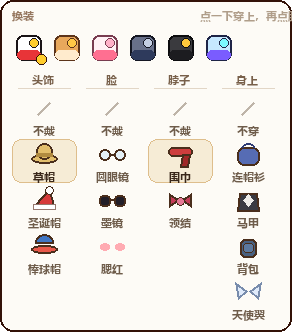
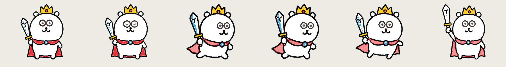
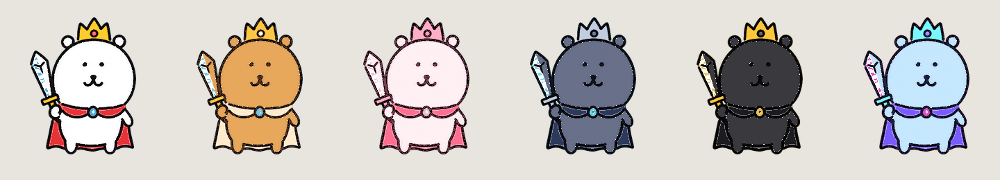
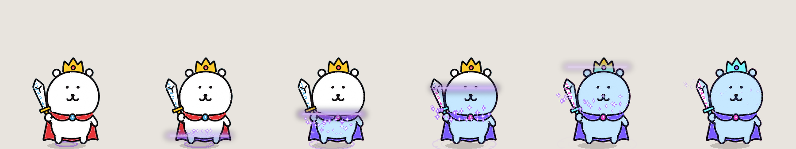
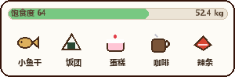
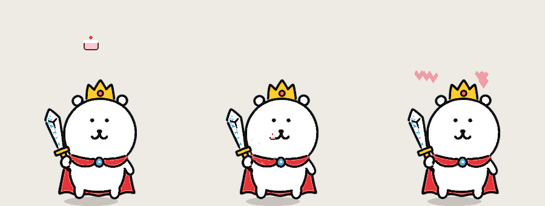
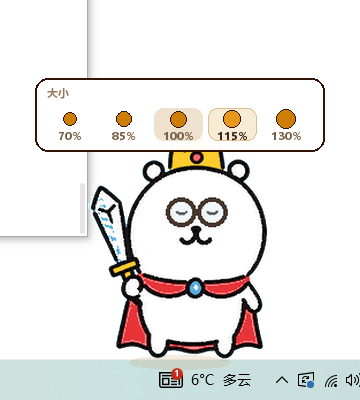
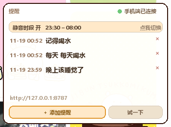

# 自嘲熊 · 桌面宠物

一只会自己走、自己敲键盘、自己躺平哭的桌面宠物，支持**换装**（穿衣服 + 换配色，
带变身动画）。动画来自 [Petdex 的 zichao-bear-2 图集](https://petdex.dev/pets/zichao-bear-2)
（白熊 + 皇冠 + 红披风 + 冰剑），9 个状态行、57 帧；窗口是 Win32 分层窗口
（`UpdateLayeredWindow` + 逐像素 alpha），透明区鼠标穿透、点熊不抢焦点、
不进任务栏、不进 Alt+Tab。


## 动画素材（图集）

| 项 | 值 |
|---|---|
| 源 | `https://assets.petdex.dev/pets/zichao-bear-3bbad0bc0da5/sprite.png`（2.4 MB） |
| 整表 | 1536 × 1872，8 列 × 9 行 |
| 单格 | 192 × 208，脚底在格内 y=203 |
| 行序 | idle(6) · running-right(8) · running-left(8) · waving(4) · jumping(5) · failed(8) · waiting(6) · running(6) · review(6) |
| 行序来源 | [petdex `src/lib/pet-states.ts`](https://github.com/crafter-station/petdex/blob/main/src/lib/pet-states.ts) |

行序不是猜的：从 petdex 仓库的状态表读出来后，用"整行/整列全透明"扫描复核 ——
9 行的帧数依次是 6/8/8/4/5/8/6/6/6，与状态表完全一致，格子边界落在 192/208 的整数倍上。

想换一只宠物：把任意 Petdex 图集（同规格）覆盖 `assets/sprite.png` 即可。

## 状态映射

| 行为 | 图集行 |
|---|---|
| 站立 / 发呆 | `idle` |
| 往右走 / 往左走 | `running-right` / `running-left`（真的有朝向） |
| 坐下 | `running` —— 抱着笔记本敲键盘 |
| 躺一会儿 | `failed` 末两帧（躺平）慢放 + zzz |
| 叹气 / 摔晕 | `failed` —— 掉眼泪 |
| 跳跃 / 被拖 / 下落 | `jumping` |
| 被戳 / 双击 | `waving` —— 举剑打招呼 |

## 换装系统

右键 → **换装**：面板上面一行是**配色**，下面是四个部位的**衣物**。
点一下穿上，再点一次脱掉，每次改动熊都会现场变身。



### 衣物（真正的穿衣服）

| 部位 | 可选 |
|---|---|
| 头饰 | 草帽 / 圣诞帽 / 棒球帽 |
| 脸 | 圆眼镜 / 墨镜 / 腮红 |
| 脖子 | 围巾 / 领结 |
| 身上 | 连帽衫 / 马甲 / 背包 / 天使翼 |

**难点是配件得跟着动画走**：图集每帧头会点、身体会缩、摔倒时整个躺下。
解决办法是给每一帧求锚点：

1. 皇冠（高饱和高亮的黄）每帧都正好坐在头顶上 → 取它的 bbox **下沿当头顶**；
2. 头顶 + 固定头半径 = 头心；脚底取 alpha 掩膜下沿；
3. **眼睛逐帧实测**：在头部区域内做连通域（深色小圆点），按"间距接近头宽 0.19 倍、
   两眼等高、面积相近"配对，得到的才是真正的脸中心 —— 皇冠左右会偏、白色行宽会被
   耳朵和剑带偏，只有眼睛是可靠的。眼镜/墨镜/腮红全部以两眼坐标为基准，
   所以走路、跳跃时也不会错位。



掩膜走 C 层：整表量化后复制一份"恒等灰度调色板"，转 L 就得到"像素值 = 调色板索引"
的图，于是按角色的 256 项 LUT 可以直接 `point()`，再用 `MinFilter` 腐蚀掉
抗锯齿串色的杂点。57 帧锚点按需算、算完缓存。

上衣（连帽衫/马甲）不是贴图，是"在角色自己身上刷色"：
`alpha 掩膜 ∩ 脖子以下脚以上的横带`，掩膜先腐蚀 7px 保住原图深色描边，再用
`Image.composite` 上色 —— 所以身体轮廓、走路的形变全都跟着原图。
身后层（背包、翅膀）先合成，再叠身体，最后是帽子/眼镜/围巾这些身前件。


### 配色

图上那 6 个色块是配色方案：原版 / 焦糖 / 樱花 / 午夜 / 黑金 / 赛博。
按"角色"重映射调色板，能和衣物自由叠加（赛博配色 + 草帽 + 围巾也行）。



```
k = v_src / v_base
k ≤ 1 → new = target × k                       # 暗部过渡到描边
k > 1 → new = lerp(target, white, (k-1)/… )    # 亮部过渡到白
```

### 变身效果



改任何一件都会播 0.95 秒变身：新样子从脚底往头顶扫上去，扫光边缘一道白线 + 光晕，
地面法阵扩张旋转，24 颗星屑升起，熊同时举剑。

**持久化**：`{"outfit": "cyber", "wear": {"neck": "scarf", "body": "hoodie"}}` 写进
`.bear.json`，下次启动直接穿这身。

**加一件衣服**只需两步（`bearpet/garment.py`）：

```python
def _draw_bucket_hat(d, a, t):          # a = 该帧锚点，t = 秒（做摆动用）
    d.ellipse([a.cx - 34, a.head_top - 6, a.cx + 34, a.head_top + 10], fill=(200, 180, 140))
    ...

ITEMS.append(Item("bucket", "渔夫帽", "head", tint=(200, 180, 140)))
FRONT_DRAW["bucket"] = _draw_bucket_hat
```

## 投喂系统

右键 → **投喂**：面板上是一排食物 + 饱食度条。点一下，食物从窗口上方掉到嘴边，
咀嚼出碎屑，吃完飘爱心，饱食度和体重跟着变。





| 食物 | 饱食度 | 体重 |
|---|---|---|
| 小鱼干 | +14 | +0.3 |
| 饭团 | +22 | +0.6 |
| 蛋糕 | +18 | +1.1 |
| 咖啡 | +4 | +0.1 |
| 辣条 | +10 | +0.4 |

- **落点是算出来的**：落点 = 当前帧锚点里眼睛的 y + 30，也就是嘴巴的位置，
  所以熊在哪儿吃、什么动作吃，食物都掉到嘴边。
- 点食物后面板**立即关闭**，食物自己掉下去；只有"吃太饱被拒绝"时面板才留着。
- **数值影响行为**：饱食度每秒 -0.09（约 18 分钟见底），低于 25 会抱怨
  "有点饿，但懒得动"；到 92 以上再喂会拒绝"够了够了，谢谢你还惦记我"。
- **体重影响体型**：`scale = 1 + (weight-50)*0.0012`，喂多了会圆一点。
- 统计（饱食度/体重/投喂次数）和装扮一起写进 `.bear.json`。

## 大小

右键 → **大小**，五档：70% / 85% / 100% / 115% / 130%。



窗口尺寸固定 300×340，缩放只作用在画布里的精灵上，所以：

- 精灵按**底部对齐**缩放，脚永远踩在同一条地平线上；
- 阴影跟着缩放（`sprite.render(scale=)` 里同步半径）；
- 气泡底部随缩放反向移动（`116 + (1-s)*203`），始终悬在头顶上方；
- 投喂落点按缩放换算（`dx + cx*s`），大号熊也能吃准；
- 最终缩放 = 体重体型 × 档位，互不冲突。

选择写进 `.bear.json` 的 `"size"`，下次启动保持。

## 定时提醒（本机自己加）

右键 → **提醒** → **＋ 添加提醒**：


- 打字框是真正的 EDIT 控件（自带中文输入法、光标、粘贴），**Enter 添加 / Esc 取消**；
- 五个快捷话术一键填：喝水 / 走走 / 吃饭 / 早睡 / 夸她；
- 时间四档一键选（现在 / 10 分钟 / 1 小时 / 20:00），也能直接填 HH:MM，
  引擎还认 in:30m、t:2026-11-20T08:00；
- 重复：不重复 / 每天 / 工作日（每天和工作日会自动排下一次，周末跳过）；
- 面板里每条右边有 × 可删；到点由**本机时钟**判定，触发时熊说话 + 提示音；
- 提醒占用 9 秒气泡优先级，不会被随机台词顶掉；静音时段内非紧急的自动压到 08:00。



## 手机远程提醒

手机上打一句话，出现在她电脑上这只熊的头顶；**什么时候说，由她电脑的本地时钟决定**。


`
手机浏览器 ──HTTPS──> relay/relay.py（VPS / 家里常开机器）<──长轮询── 她电脑上的桌宠
`

- 手机端是一个网页（
elay.py 直接吐 HTML），不用装 App；
- 电脑端长轮询 + since 落盘，关机/断网期间的消息下次连上自动补发；
- 时间规格由手机发、本机解析："（立刻）/ in:10m / 20:00（下一个 20:00）/
  
epeat: daily|weekday；
- 静音时段 23:30–08:00：非紧急提醒压到 08:00 再补，紧急的立刻送达；
- 右键 → **提醒** 可以看到排队中的提醒、连接状态，并一键切换静音。

部署方式（局域网 / VPS+HTTPS / Cloudflare Tunnel）、systemd 单元、令牌与
隐私边界都写在 [relay/README.md](relay/README.md)。


## 快速开始

**原生可执行程序**（自带 Python，双击即可，不需要装 Python）：

| 系统 | 生成方式 | 产物 |
|---|---|---|
| Windows | 双击 `build_windows.bat`（需在 Windows 上运行） | `自嘲熊.exe` |
| macOS | `./build_mac.sh` | `自嘲熊.app` |

两个构建脚本用的是同一份源码，PyInstaller 会把 Python、Pillow、PyObjC 和图集
全部打进产物；改动源码后重新构建即可。exe 无法在 macOS 上交叉编译，所以
Windows 版请在 Windows 机器上跑一次 `build_windows.bat`。

Windows：

```
双击  启动自嘲熊.bat        （或 启动自嘲熊.vbs，完全无控制台）
双击  关闭自嘲熊.bat        （或右键熊 → 退出）
```

macOS（推荐 .app）：

```
./build_mac.sh        # 生成自带 Python 的 自嘲熊.app（约 80 MB）
双击  自嘲熊.app      # 可拖到「应用程序」，状态存在 ~/Library/Application Support/自嘲熊
右键熊 → 退出          # 或用 关闭自嘲熊.command
```

也可以不打包，直接 `python3 main.py` 或双击 `启动自嘲熊.command`。

命令行：Windows 用 `python main.py`，macOS 用 `python3 main.py`。

依赖：Pillow 已装在项目内的 `.deps`，无需系统 pip；macOS 还需要 PyObjC
（`AppKit` / `Cocoa` / `Quartz`），也已放进 `.deps`。
换机器重装：`pip install --target .deps pillow pyobjc-framework-cocoa`。
两个后端的公开 API 完全一致，换装/投喂/提醒/菜单等所有功能在两端表现相同。

## 它会做什么

| 状态 | 表现 |
|---|---|
| 走动 | 8 帧跑步循环，左右分别用 `running-right` / `running-left` |
| 站立 | 呼吸 + 眨眼循环，眼珠跟着鼠标转（程序化回退造型才有） |
| 坐下 | 抱着笔记本敲键盘 |
| 躺一会儿 | 躺平 + zzz |
| 叹气 | 掉眼泪那两帧 |
| 跳跃 | 小跳，落地回站立 |
| 被拖 | 举剑乱蹬、随鼠标甩动 |
| 被扔 | 带初速度抛出，重力下落，落地速度 > 720 px/s 摔晕 |
| 说话 | 随机自言自语，气泡淡入淡出（`bearpet/lines.py`） |
| 夸主人 | 闲着的时候每隔 45~95 秒夸一句，气泡停留 5.6 秒 |

**它没事就夸你**：20 多条小短文轮着说，边夸边自嘲 ——
"你笑起来的时候，我这只熊都觉得自己没那么失败了" /
"别的不敢说，你的好看是客观事实" /
"我一无是处，唯一优点是眼光好"。


精力值随走动下降、睡觉恢复；越困越容易就地睡过去。

## 操作

| 操作 | 效果 |
|---|---|
| 左键拖拽 | 抓起熊，松手带抛掷初速度 |
| 左键单击 | 戳一下，举剑挥手 + 说句话；睡着时会被戳醒 |
| 左键双击 | 换一句话说 |
| 右键 | 菜单：说句话 / 敲会儿键盘 / 躺一会儿 / 投喂 / 换装 / 大小 / 提醒 / 退出 |

## 结构

```
desktop-bear/
├─ build_windows.bat       Windows 打包脚本 → 自嘲熊.exe
├─ build_mac.sh            macOS 打包脚本 → 自嘲熊.app（自带 Python）
├─ 启动自嘲熊.py           通用启动器（未打包时共用）
├─ 自嘲熊.app              macOS 应用包（make_app.sh 生成）
├─ main.py                 入口（平台单实例锁 + 依赖路径注入）
├─ bearpet/
│  ├─ winlayer.py          窗口后端分发（Windows / macOS）
│  ├─ winlayer_win.py      Win32 分层窗口后端
│  ├─ maclayer.py          macOS AppKit 透明窗口后端
│  ├─ editor.py            提醒编辑器分发
│  ├─ editor_win.py        Win32 EDIT + GDI 版编辑器
│  ├─ editor_mac.py        macOS NSTextField 版编辑器
│  ├─ paths.py             运行期可写目录（macOS → Application Support）
│  ├─ sprite.py            Petdex 图集读取/切格/播放（主渲染路径）
│  ├─ outfit.py            配色：调色板角色化重映射 + 6 套预设
│  ├─ garment.py           衣物：每帧锚点（含眼睛实测）+ 12 件可穿戴单品
│  ├─ wardrobe.py          换装面板 UI（配色行 + 四部位格子）
│  ├─ food.py              投喂：5 种食物、掉落/咀嚼/爱心动画、投喂面板
│  ├─ size.py              大小：五档缩放面板
│  ├─ reminder.py          提醒引擎：时间解析/静音/重复
│  ├─ remote.py            远端客户端：长轮询 + since 落盘
│  ├─ remind_ui.py         提醒面板
│  ├─ editor.py            添加提醒输入窗（Win32 + EDIT，中文输入法可用）
│  ├─ fx.py                变身特效：扫光 / 法阵 / 星屑
│  ├─ art.py               程序化矢量熊（回退）+ 气泡/zzz 绘制
│  ├─ brain.py             行为状态机：状态切换、精力、台词调度
│  ├─ winlayer.py          Win32 分层窗口：逐像素 alpha、置顶、不抢焦点
│  ├─ app.py               主循环、物理、鼠标交互、自绘菜单
│  └─ lines.py             自嘲台词库
├─ relay/                 手机端中继服务（纯标准库）+ 手机网页 + 部署说明
├─ assets/sprite.png       Petdex 图集（1536×1872），换皮就换这个文件
├─ assets/petdex-zichao-bear-2.zip   原始下载包（含 pet.json）
├─ .bear.json              换装持久化
├─ tools/selftest.py       交互自测：菜单 / 拖拽 / 落地 / 点击 / 20 秒自主行为
├─ tools/test_outfit.py    配色自测
├─ tools/test_wear.py      衣物自测（穿/脱/叠加配色/走路跟随）
├─ tools/test_feed.py      投喂自测（掉落→咀嚼→爱心→数值→拒绝→体型）
├─ tools/test_size.py      大小自测（五档→缩放/气泡/落点/持久化）
├─ tools/test_remote.py    手机→电脑链路自测（中继+桌宠全链路）
├─ tools/test_local_reminder.py  本地定时提醒自测
├─ .deps/                  Pillow（项目内依赖）
└─ preview/                渲染与实测截图
```

## 自测

```
python tools/selftest.py     # 交互
python tools/test_wear.py    # 换装（衣物）
python tools/test_outfit.py  # 换装（配色）
python tools/test_feed.py    # 投喂
python tools/test_size.py    # 大小
python tools/test_remote.py  # 手机→电脑提醒
```

全部走真实 Win32 消息通路（`PostMessage` + `SetCursorPos`）。最近一次结果：

```
selftest:   拖拽→抛掷→落地 dizzy，点击→'嗯，我在，但我没什么用'→起跳
test_wear:  wardrobe open=True 292x332
            草帽 → wear={'head':'straw'}；围巾 → 连帽衫 → 三件套
            配色「赛博」→ outfit=cyber，衣物保持不变
            再点草帽 → 脱下；config 落盘 {"outfit":"cyber","wear":{...}}
            render+wear ms/frame=5.19
test_outfit: 菜单 → 换装 → 变身三段扫光 → outfit=cyber → 樱花；无衣物时 0.19 ms/帧
test_feed:  投喂面板 300x98 → 点蛋糕 → 面板立即关闭 → fall → eat → happy
            satiety 61.86→65.63，weight 50.0→50.1，fed 0→1
            饱食度 95 时再喂被拒绝「再吃就要变成球了」，且面板保留
            weight=78 时 scale=1.034；config 落盘含 stats
test_size:  面板 290x74 → 130% / 70% / 100% 三档点选均正确
            130% 时 bubble_bottom 54.3、70% 时 176.5（气泡跟着缩放走）
            130% 下嘴巴落点 (168.4,201.1) 与缩放换算完全一致，投喂正常
            config 落盘含 size: 1.0
```

## 调参

| 想改什么 | 改哪里 |
|---|---|
| 台词 | `bearpet/lines.py` |
| 单品格子/图标 | `bearpet/garment.py`（`_draw_*`）与 `bearpet/wardrobe.py`（`_icon`） |
| 配色方案 | `bearpet/outfit.py` 的 `OUTFITS` |
| 变身时长/粒子 | `bearpet/fx.py` 的 `DURATION`、`PARTICLES` |
| 走多快、多久换状态 | `bearpet/brain.py` 的 `_enter()` / `_choose_next()` |
| 大小档位 | earpet/size.py 的 STEPS / LABELS |
| 夸主人的频率/台词 | `bearpet/brain.py` 的 `_praise_tick()`、`bearpet/lines.py` 的 `COMPLIMENT_LINES` |
| 重力、摔晕阈值、帧率 | `bearpet/app.py` 顶部的 `GRAVITY/MAX_FALL/HARD_LAND/FPS` |

## 已知限制

- 只贴在工作区底部（任务栏上沿）走，不会爬窗口或换层。
- 多显示器：掉到哪块屏幕就按哪块屏的工作区落地，不会主动跨屏游走。
- 衣物是"程序化画在帧上"的，不是图集自带；形状固定的配件（帽子/眼镜）跟随效果好，
  大幅变形的帧（摔倒躺平）上围巾之类会有点飘。
- 带衣物渲染 5.2 ms/帧，45 FPS 上限；低配可把 `FPS` 调到 30。

## 程序化回退造型

`bearpet/art.py` 里保留了手写的矢量熊（轻松熊配色 `#CE7E05` / `#FFC61A` / `#331208`），
图集读不到时自动回退，气泡和 zzz 也复用它的绘制函数。
